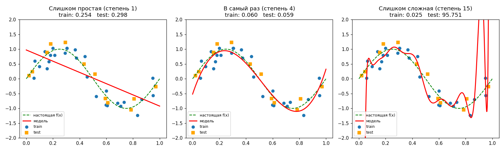
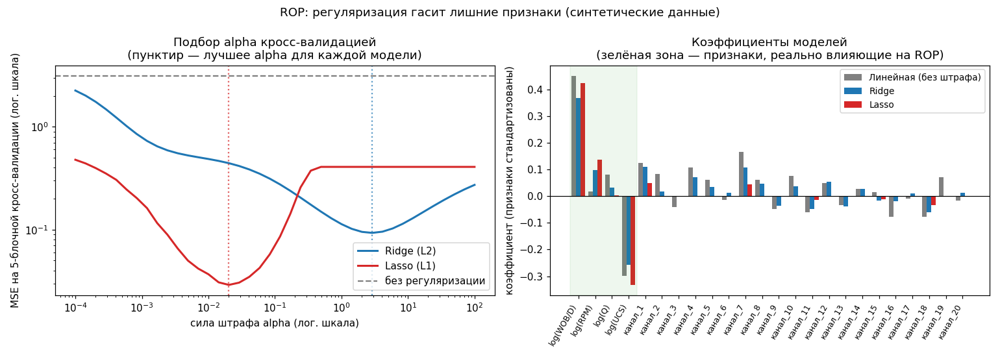
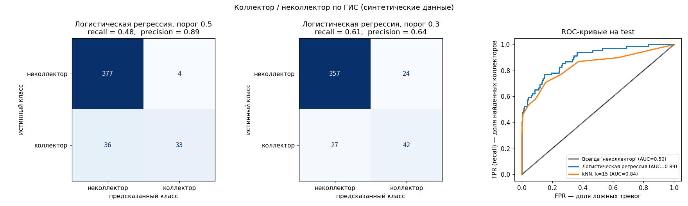
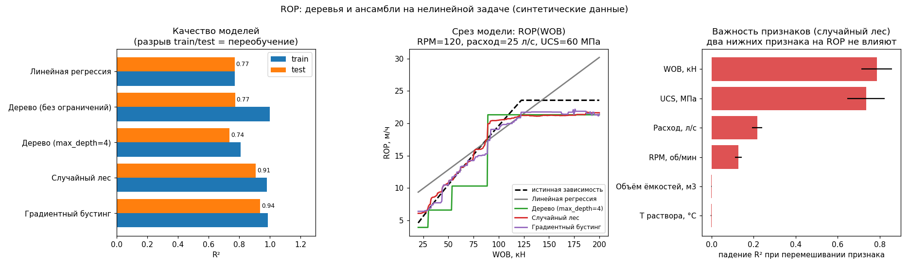
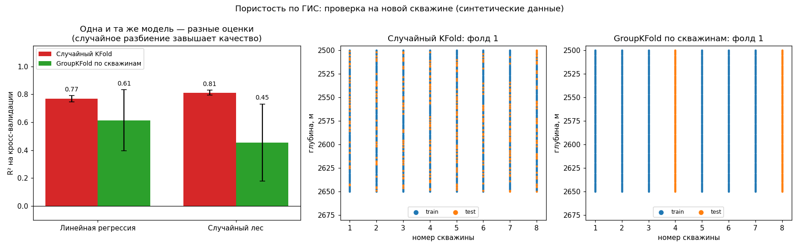

# 🛢️ ml-practice — практика по машинному обучению

Практические работы по курсу «Введение в машинное обучение» (лекции 1–3).
Автор — студент направления «Технология бурения нефтяных и газовых скважин»,
поэтому задачи по возможности взяты из бурения и петрофизики: механическая
скорость проходки (ROP), выделение коллекторов по ГИС, пористость по каротажу.

Каждая практика — один самостоятельный скрипт: генерирует данные, обучает
модели, печатает короткую сводку в консоль и сохраняет график рядом с собой.

> **Все данные синтетические.** Они генерируются в коде по упрощённым
> формулам (например, модель ROP типа Бингхэма + шум). Цель — показать
> методы ML на понятных инженеру задачах, а не получить промысловые выводы.

## Практики

| № | Тема | Что показывает | Ключевой вывод | График |
|---|------|----------------|----------------|--------|
| 01 | [Недообучение и переобучение](01_overfitting/main.py) | Полиномы степени 1, 4 и 15 на одних и тех же зашумлённых точках | Ошибка на train падает с ростом сложности, а на test у степени 15 взлетает до ~96 против 0.06 у степени 4: смотреть надо только на test |  |
| 02 | [Линейная регрессия и регуляризация](02_regularization/main.py) | ROP по WOB, RPM, расходу и прочности породы + 20 «лишних» каналов; Ridge и Lasso, alpha подбирается 5-блочной кросс-валидацией | На 30 точках обычная регрессия даёт R² = 0.48 на test, Lasso — 0.90 и обнуляет бо́льшую часть шумовых признаков. Масштабирование перед штрафом обязательно |  |
| 03 | [Классификация и метрики](03_classification/main.py) | Коллектор / неколлектор по ГК, RHOB, NPHI, RT; логистическая регрессия, kNN и «всегда неколлектор» | При 15 % коллекторов «пустая» модель имеет accuracy 0.85. Логистическая регрессия: accuracy 0.91, но recall всего 0.48; снижение порога до 0.3 поднимает recall до 0.61 ценой precision |  |
| 04 | [Деревья решений и ансамбли](04_trees_ensembles/main.py) | ROP с «точкой перегиба» по нагрузке; линейная регрессия, дерево, случайный лес, градиентный бустинг, перестановочная важность признаков | Одиночное дерево запоминает train (R² = 1.00) и даёт 0.77 на test; лес и бустинг — 0.91 и 0.94, ловят перегиб. Шумовые признаки получают нулевую важность |  |
| 05 | [Кросс-валидация по скважинам](05_group_cv/main.py) | Пористость по ГИС в 8 скважинах; случайный KFold против GroupKFold | Случайное разбиение завышает R² случайного леса с 0.45 до 0.81: соседние по глубине точки «подсказывают» ответ. Для новой скважины честна только оценка по группам |  |

### Связь с лекциями

| Лекция | Темы лекции | Практики |
|--------|-------------|----------|
| 1 | Обучение с учителем, регрессия и классификация, ошибка модели, смещение и дисперсия, параметрические и непараметрические модели (kNN) | 01, 03 |
| 2 | Логистическая регрессия, матрица ошибок, precision/recall, ROC-кривая; отложенная выборка и k-блочная кросс-валидация; регуляризация Ridge/Lasso, масштабирование признаков | 02, 03, 05 |
| 3 | Деревья решений, переобучение деревьев, важность признаков, бэггинг, случайный лес, бустинг | 04 |

## Как запустить

Нужен Python 3.9 или новее.

```bash
git clone https://github.com/xarebovdavid/ml-practice.git
cd ml-practice

python3 -m venv .venv
source .venv/bin/activate          # Windows: .venv\Scripts\activate
pip install -r requirements.txt

python3 01_overfitting/main.py     # любая практика запускается так же
```

Скрипт печатает таблицу метрик и сохраняет PNG в папку практики.
Каждый скрипт работает несколько секунд.

Проверить, что все практики запускаются и сохраняют графики:

```bash
python3 -m pytest -q
```

## Структура

```
ml-practice/
├── 01_overfitting/        main.py + overfitting.png
├── 02_regularization/     main.py + regularization.png
├── 03_classification/     main.py + classification.png
├── 04_trees_ensembles/    main.py + trees_ensembles.png
├── 05_group_cv/           main.py + group_cv.png
├── tests/                 дымовой тест всех практик
├── requirements.txt
└── LICENSE
```

## Стек

Python 3.9+, NumPy, scikit-learn, Matplotlib, pytest.

## Лицензия

[MIT](LICENSE)
